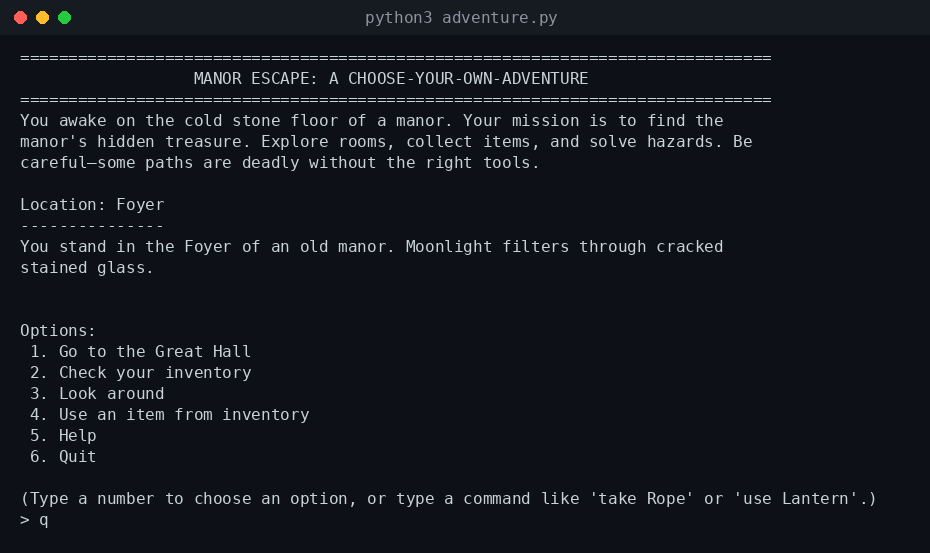
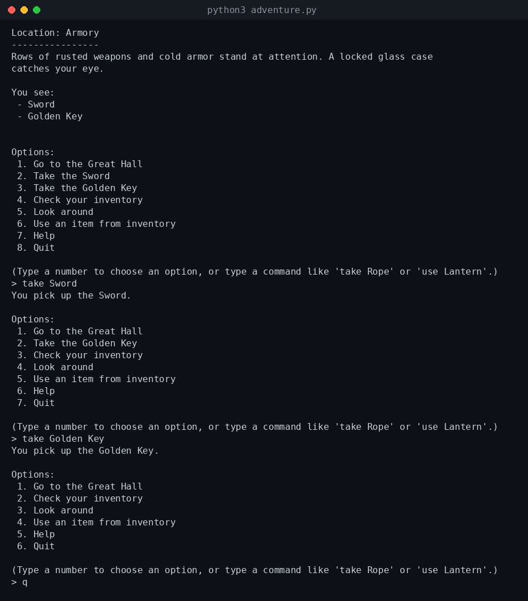
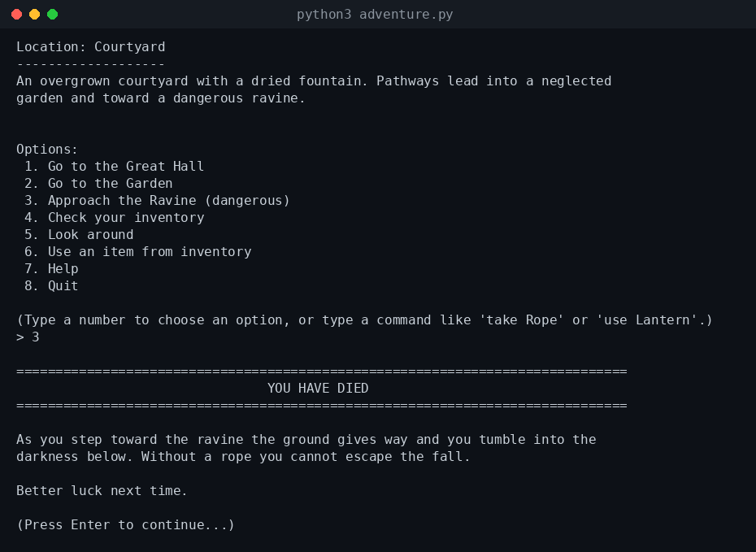
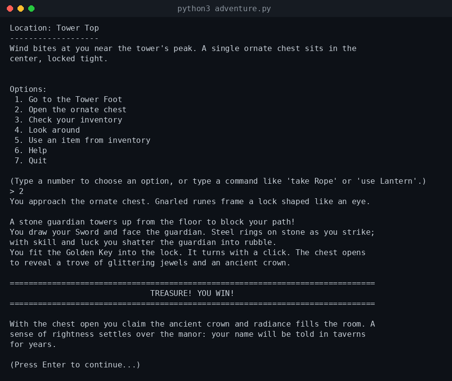
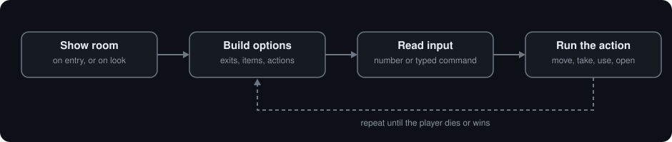
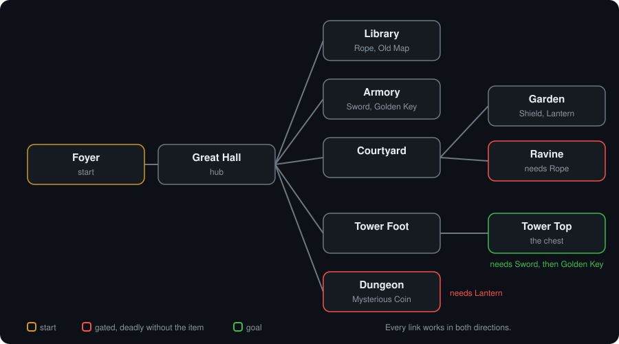

<h1 align="center">Manor Escape</h1>

<p align="center">
A text adventure for the terminal. One Python file, no dependencies.<br>
Built with GitHub Copilot for MLH Global Hack Week: Hacktoberfest 2026.
</p>

<p align="center">
<sub>Python 3.8+ &nbsp;|&nbsp; standard library only &nbsp;|&nbsp; one file: <code>adventure.py</code></sub>
</p>

<p align="center">

</p>

## The game

You wake up in the Foyer of an old manor. Somewhere inside is a chest guarded by a stone figure. Explore the rooms, pick up what you can carry, and work out what you need before you try anything dangerous.

- 10 rooms, from the Great Hall to the Dungeon and the Tower Top
- An inventory you fill with `take` and use with `use`
- Gated rooms that kill you if you walk in unprepared
- One way to win and several ways to lose

## Quickstart

You need Python 3.8 or newer. Nothing to install.

```bash
git clone https://github.com/manav4u/ghw-copilot-adventure-game.git
cd ghw-copilot-adventure-game
python3 adventure.py
```

## Playing

Every room lists numbered options. Type a number, or type a command.

| Command | What it does |
| --- | --- |
| `take <item>` | Pick up an item listed in the room |
| `use <item>` | Use or inspect something you carry |
| `inventory` or `i` | List what you are carrying |
| `look` or `l` | Describe the current room again |
| `map` or `m` | Read the Old Map, if you have found it |
| `help` or `h` | Show the command list |
| `quit` or `q` | Leave the manor |

## A few moments from a real run

These are captured from `python3 adventure.py`, not mocked up.

**Picking things up.** Items show up as options and as typed commands. Once an item is taken, its option disappears from the room.

<p align="center">

</p>

**Dying.** Walk toward the Ravine without a Rope and the game ends.

<p align="center">

</p>

**Winning.** Open the chest on the Tower Top with the right items in your bag.

<p align="center">

</p>

## How it works

The whole engine is about 400 lines in one file. It has three parts: a world described as data, a small amount of state, and a loop that turns input into actions.

### The loop

<p align="center">

</p>

`main_loop()` rebuilds the option list on every pass. Movement options come from the room's exits, pick-up options come from the room's items, and a room-specific action such as opening the chest is added only where it makes sense. Typed commands like `take Rope` are checked first in `parse_command()`. If the input is a number, it picks from the option list. Anything else gets a polite "I didn't understand that".

### The room graph

<p align="center">

</p>

Rooms live in one `rooms` dictionary. Each room has a description, a list of exits and a list of items:

```python
"Armory": {
    "desc": "Rows of rusted weapons and cold armor stand at attention. ...",
    "exits": ["Great Hall"],
    "items": ["Sword", "Golden Key"]
},
```

Adding a room means adding one entry and listing it in a neighbour's `exits`. The options menu picks it up by itself.

### State and inventory

Everything that changes is in one `state` dictionary:

```python
state = {
    "location": "Foyer",
    "inventory": [],
    "chest_opened": False,
    "alive": True,
    "won": False,
    "visited": set()
}
```

The inventory is a plain list of item names. `take_item()` moves a name from the room's `items` into `state["inventory"]`, so an item can only be picked up once. Game rules are checks against that list.

<details>
<summary><b>Spoilers: win and lose logic</b></summary>

<br>

The rules are `if` checks in two places, `move_to()` and `open_chest()`:

| Where | Check | If it fails |
| --- | --- | --- |
| Entering the Ravine | `Rope` in inventory | You fall and the game ends |
| Entering the Dungeon | `Lantern` in inventory | A hidden pit ends the game |
| Opening the chest | `Sword` in inventory | The guardian crushes you |
| Unlocking the chest | `Golden Key` in inventory | The chest stays locked and you can try again |

Pass the last check and `win()` runs. `lose()` and `win()` both print their ending screen and exit.

A few items are flavour only. The Old Map shows a hint map, and the Shield and the Mysterious Coin do nothing to the outcome.

</details>

## Project layout

```text
.
|-- adventure.py   world data, state, commands, endings
|-- docs/          screenshots and diagrams used in this README
`-- README.md
```

## How it was built

This is my submission for the **Build a Simple App with Copilot** challenge in MLH [Global Hack Week: Hacktoberfest](https://ghw.mlh.com/events/open-source) (October 9 to 15, 2026).

The world, the commands and the endings were written with GitHub Copilot. I played the game to check it, and kept it to one file with no dependencies so the whole thing reads top to bottom in one sitting.
